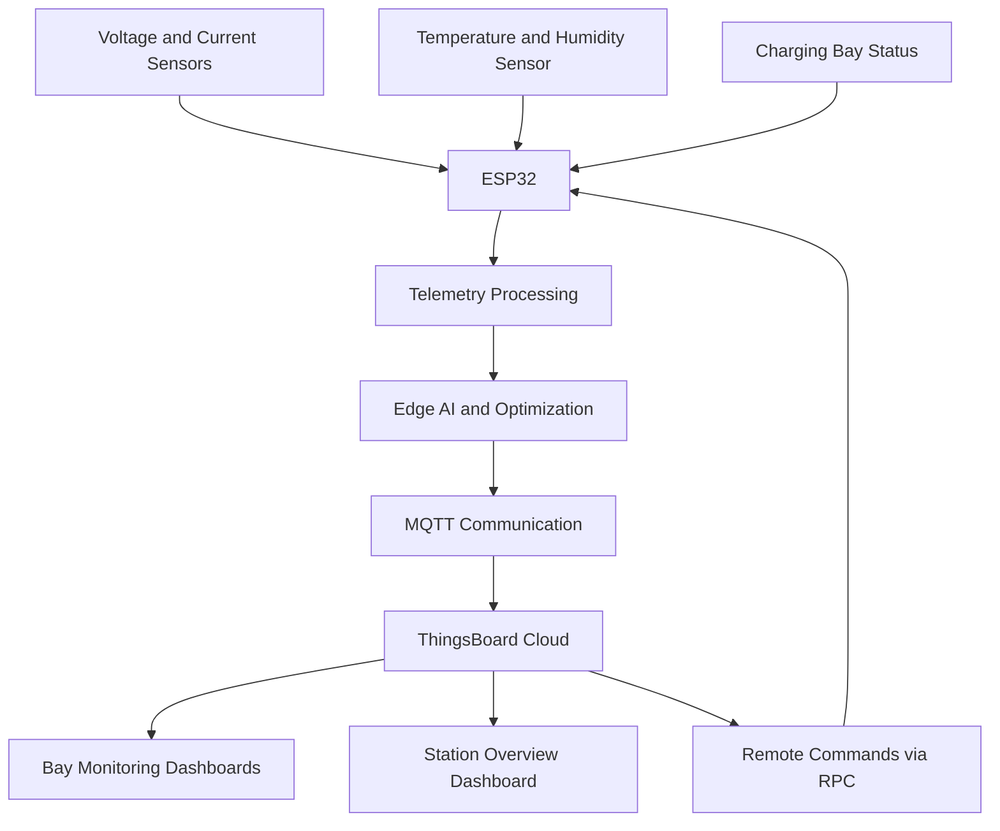

# ⚡ Edge AI-Based Smart EV Charging Station Optimizer

An ESP32-based smart EV charging station monitoring and optimization system that combines embedded sensing, Edge AI-based predictions, MQTT communication, and cloud visualization to support intelligent charging-bay management.

## 📌 Overview

As electric vehicle adoption increases, charging stations need better visibility into bay availability, electrical parameters, and charging demand. This project explores an embedded IoT approach to monitoring charging bays and making data-driven charging decisions.

The system uses an **ESP32 microcontroller** to collect sensor data, process charging-bay information, and transmit telemetry to **ThingsBoard Cloud** using MQTT. An Edge AI and optimization layer is intended to estimate arrival probability and charging duration and support load-management decisions.

## 🎯 Objectives

- Monitor charging-bay status and electrical parameters.
- Collect sensor data using an ESP32-based embedded system.
- Publish real-time telemetry to ThingsBoard Cloud through MQTT.
- Estimate vehicle arrival probability and charging duration using the Edge AI component.
- Support intelligent load-management decisions.
- Visualize bay-level information and station-level status through cloud dashboards.
- Explore remote monitoring and control using ThingsBoard RPC.

## 🏗️ System Architecture



*Architecture overview: the exact data flow depends on the implemented firmware modules and the configured ThingsBoard dashboard.*

## 🧰 Hardware and Technologies

| Category | Components / Technologies |
|---|---|
| Microcontroller | ESP32 development board |
| Temperature and humidity | DHT22 sensor |
| Electrical monitoring | Voltage and current sensing inputs |
| Firmware framework | Arduino framework |
| Development environment | PlatformIO, Visual Studio Code |
| Programming language | C++ |
| Cloud platform | ThingsBoard Cloud |
| Communication protocol | MQTT |
| Data format | JSON |
| Simulation | Wokwi, where configured |
| Version control | Git and GitHub |

## ✨ Key Features

### 1. Charging-Bay Monitoring
Collects sensor readings and bay-state information for monitoring charging-bay conditions.

### 2. Electrical Parameter Telemetry
Supports telemetry fields for voltage, current, power, and temperature. Humidity may also be reported when the corresponding sensor is configured.

### 3. Edge AI-Based Prediction
The Edge AI component is intended to estimate:
- Vehicle arrival probability
- Predicted charging duration
- Charging or load-management decisions

Prediction accuracy depends on the model, input data, and validation process used in the implementation.

### 4. Cloud Dashboard
ThingsBoard provides a centralized interface for viewing telemetry, monitoring charging bays, and reviewing system status.

The planned dashboard structure includes:
- **Bay 1 Monitoring**
- **Bay 2 Monitoring**
- **Bay 3 Monitoring**
- **Smart Charging Station – AI Overview**

### 5. MQTT Communication
The ESP32 publishes telemetry to ThingsBoard using MQTT. Each configured ThingsBoard device uses its own access token.

### 6. Remote Monitoring and Control
The project includes an RPC module for exploring remote commands from ThingsBoard to the ESP32. Supported commands depend on the firmware implementation.

## 📊 Telemetry Parameters

The firmware may publish the following telemetry fields, depending on the active configuration:

| Parameter | Description |
|---|---|
| `bayId` | Charging-bay identifier |
| `bayStatus` | Charging-bay status |
| `voltage` | Measured or simulated voltage |
| `current` | Measured or simulated current |
| `power` | Calculated or reported power |
| `temperature` | Temperature reading |
| `humidity` | Humidity reading |
| `arrivalProbability` | Estimated vehicle arrival probability |
| `predictedDuration` | Predicted charging duration, if implemented under this key |
| `loadDecision` | Output of the load-management logic |
| `throttleLevel` | Configured load-throttling level |
| `overload` | Overload status indicator |

**Note:** Telemetry key names must match the firmware and ThingsBoard configuration exactly. If your implementation uses `predictedDurationMin` instead of `predictedDuration`, use the actual key in the dashboard.

## 📁 Project Structure

```text
Smart-EV-Charging-with-ESP32/
├── include/
│   ├── Edge_AI.h
│   ├── Model.h
│   ├── Peripherals.h
│   ├── State.h
│   ├── attributes.h
│   ├── bay_network.h
│   ├── config.h
│   ├── optimization.h
│   ├── rpc.h
│   ├── secrets.example.h
│   └── telemetry.h
├── src/
│   ├── Edge_Ai.cpp
│   ├── Peripherals.cpp
│   ├── State.cpp
│   ├── attributes.cpp
│   ├── bay_network.cpp
│   ├── main.cpp
│   ├── optimization.cpp
│   ├── rpc.cpp
│   └── telemetry.cpp
├── test/
│   ├── diagram.json
│   └── wokwi.toml
├── diagram.json
├── platformio.ini
├── wokwi.toml
└── README.md
```

*This tree reflects the discussed project files. Verify the names against your current repository before publishing.*

## 🚀 Getting Started

### Prerequisites

Install the following tools:

- [Visual Studio Code](https://code.visualstudio.com/)
- [PlatformIO IDE](https://platformio.org/install/ide?install=vscode)
- [Git](https://git-scm.com/)
- A ThingsBoard Cloud account
- An ESP32 development board or a compatible Wokwi simulation setup

### 1. Clone the Repository

```bash
git clone https://github.com/Bharani-dev/Smart-EV-Charging-with-ESP32.git
cd Smart-EV-Charging-with-ESP32
```

### 2. Open the Project

Open the project directory in Visual Studio Code and allow PlatformIO to install the dependencies declared in `platformio.ini`.

### 3. Configure Credentials

Review `include/config.h` and `include/secrets.example.h` to understand the required configuration.

Configure your Wi-Fi credentials, ThingsBoard MQTT host, port, device access token, and active bay identifier as required by the firmware.

**Security recommendations:**
- Never commit real Wi-Fi passwords or ThingsBoard access tokens.
- Keep private credentials in a local, Git-ignored configuration file.
- Commit only placeholder values in example configuration files.
- If a token has been exposed publicly, revoke or rotate it.

### 4. Configure the ThingsBoard Device

1. Create a device in ThingsBoard Cloud.
2. Obtain the device's access token.
3. Configure the firmware to use that device's token.
4. Confirm that the MQTT host and port match your ThingsBoard configuration.
5. Create a dashboard and add widgets for the telemetry keys published by the firmware.

### 5. Build and Upload

Connect your ESP32 board and select the correct PlatformIO environment.

Build the firmware:

```bash
pio run
```

Upload it to the ESP32:

```bash
pio run --target upload
```

Open the serial monitor to inspect connection status and debug output:

```bash
pio device monitor
```

The required upload port and serial settings depend on your hardware and `platformio.ini` configuration.

## 🧪 Simulation

If the Wokwi configuration is available in your repository:

1. Open the project in Visual Studio Code.
2. Install or enable the required Wokwi extension.
3. Open `diagram.json`.
4. Start the simulation using the configured workflow.
5. Check serial output and confirm whether telemetry reaches ThingsBoard.

Simulation behavior depends on the configured components, network access, and simulator settings.

## 📈 Expected Results

After successful configuration, the system should be able to demonstrate the implemented features, such as:


- Sensor readings collected by the ESP32.
- Charging-bay status updates.
- MQTT telemetry reaching ThingsBoard.
- Cloud visualization of the reported parameters.
- Edge AI predictions and optimization outputs, if enabled and validated.
- Remote commands, if the RPC path is configured and tested.


**Bharanidharan R.**

- GitHub: [Bharani-dev](https://github.com/Bharani-dev)
- LinkedIn: [bharanidharan-tech](https://www.linkedin.com/in/bharanidharan-tech/)

